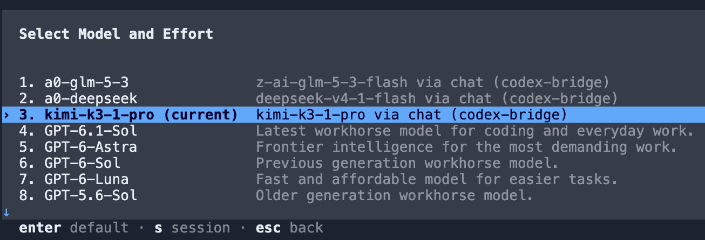

# codex-bridge

- Use external models alongside your ChatGPT subscription in Codex CLI
- Configure any chat completions endpoint and model and merge with Codex model list
- Change models on the fly with `/model` selector



## Quick guide

```sh
# Edit the models config
codex-bridge edit

# Start the proxy service
codex-bridge start

# Sync models (--force restarts the Codex server)
codex-bridge sync --force

# Start Codex as usual and choose a model with /model
codex
```

## Install

Linux and macOS, on amd64 or arm64:

```sh
curl -fsSL https://raw.githubusercontent.com/agent0ai/codex-bridge/main/install.sh | sh
```

The installer detects your OS and architecture and installs the latest release to `~/.local/bin/codex-bridge`. It requires `curl` and a POSIX shell; no Go installation is needed.

To update an installed bridge and restart its proxy immediately:

```sh
codex-bridge update
```

### PATH

If `~/.local/bin` is not already on PATH, add it for this shell and put the same line in `~/.zshrc` (macOS's default Zsh) or `~/.bashrc` (Bash) for future terminals:

```sh
export PATH="$HOME/.local/bin:$PATH"
```

[Config](config.example.yaml) · [Guide](docs/guide.md) · [MIT License](LICENSE) · [Contributing](CONTRIBUTING.md) · [Third-party notices](THIRD_PARTY_NOTICES.md)

---

<p align="center">
  Made by <a href="https://agent-zero.ai">Agent Zero</a>
</p>
<p align="center">
  <a href="https://agent-zero.ai">Website</a> ·
  <a href="https://github.com/agent0ai">GitHub</a> ·
  <a href="https://discord.gg/B8KZKNsPpj">Discord</a> ·
  <a href="https://x.com/Agent0ai">X</a> ·
  <a href="https://www.youtube.com/@AgentZeroFW">YouTube</a> ·
  <a href="https://github.com/sponsors/agent0ai">Sponsor</a>
</p>
